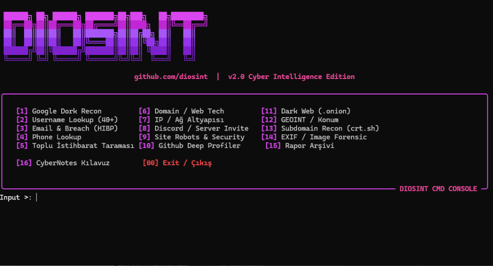

# DIOSINT

Fast, asynchronous OSINT reconnaissance framework for passive information gathering across usernames, IPs, domains, subdomains, emails, and media metadata. Built with Python, `httpx`, and `rich`.



---

## Features

- **Username Recon:** Queries 40+ platforms asynchronously via `httpx` with detailed GitHub profile extraction.
- **Subdomain Discovery:** Passive enumeration using Certificate Transparency (`crt.sh`) logs without sending traffic to the target domain.
- **IP & Network Intel:** Geolocation, ASN, ISP, organization, PTR reverse DNS, and proxy/hosting detection.
- **EXIF Forensics:** Extracts metadata, camera specs, software, and embedded GPS coordinates (with direct Google Maps links) from image files.
- **Email OSINT:** RFC 5322 syntax validation, MX verification, HaveIBeenPwned breach check, and Holehe-style account existence checks (Spotify, Microsoft/O365, GitHub, GitLab, Gravatar, Duolingo, ProtonMail, Chess.com, Docker Hub, Archive.org).
- **Web Recon & Framework Profiling:** Deep technology fingerprinting across 50+ signatures (React, Next.js, Vue, Nuxt, Angular, Django, Laravel, Rails, WordPress, Shopify), SSL/TLS certificate inspection, DNS security posture (SPF/DMARC/MX), and HTTP header audit.
- **Tor / Dark Web:** Queries Ahmia.fi index for `.onion` services.
- **GEOINT:** Reverse geocodes coordinates to street addresses using OpenStreetMap Nominatim.
- **Relation Mapping:** Builds node-edge entity graphs using NetworkX and exports interactive HTML charts (pyvis).
- **Automated Reporting:** Generates clean HTML executive reports and raw JSON data.

---

## Installation

### Standard Setup

```bash
git clone https://github.com/kayradivrik/DIOSINT.git
cd DIOSINT

python -m venv venv
source venv/bin/activate  # On Windows: venv\Scripts\activate

pip install -r requirements.txt
```

### Docker

```bash
docker build -t diosint .
docker run -it diosint
```

---

## Configuration (Optional)

Copy `.env.example` to `.env` if you want to use Shodan, VirusTotal, or Tor proxying:

```bash
cp .env.example .env    # Windows: copy .env.example .env
```

```ini
SHODAN_API_KEY=your_key_here
VIRUSTOTAL_API_KEY=your_key_here
HIBP_API_KEY=your_key_here
USE_TOR=false
```

---

## Usage

### 1. Interactive Terminal Console (Recommended)

Run the menu-driven console with Rich formatting:

```bash
python terminal_app.py
```
*(On Windows you can also double-click `diosint.bat`)*

### 2. Command Line (CLI)

Run specific reconnaissance modules directly:

```bash
# Username lookup
python main.py username --target johndoe

# IP intelligence
python main.py ip --target 1.1.1.1 --shodan

# Passive subdomain discovery
python main.py subdomains --target example.com

# Image EXIF analysis
python main.py exif --file evidence.jpg

# Web technology & header audit
python main.py scrape --target https://example.com

# Email breach check
python main.py email --target user@domain.com
```

All reports are saved under the `reports/` directory.

---

## Legal Disclaimer / Kullanim Sozlesmesi

> **"Bu araç yalnızca yasal güvenlik testleri, sızma testi izin belgeli sistemler ve eğitim amaçlı geliştirilmiştir. İzinsiz hedeflere karşı kullanımında tüm yasal sorumluluk kullanıcıya aittir."**

This tool is created for educational purposes, security auditing, and authorized penetration testing only. Do not use this tool against any system without explicit prior permission. For full legal terms, refer to [DISCLAIMER.md](DISCLAIMER.md).

## License

[MIT](LICENSE) © 2026 Kayra Divrik

